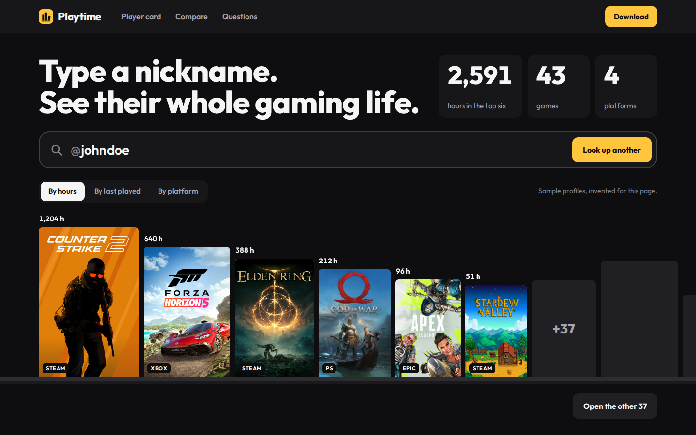
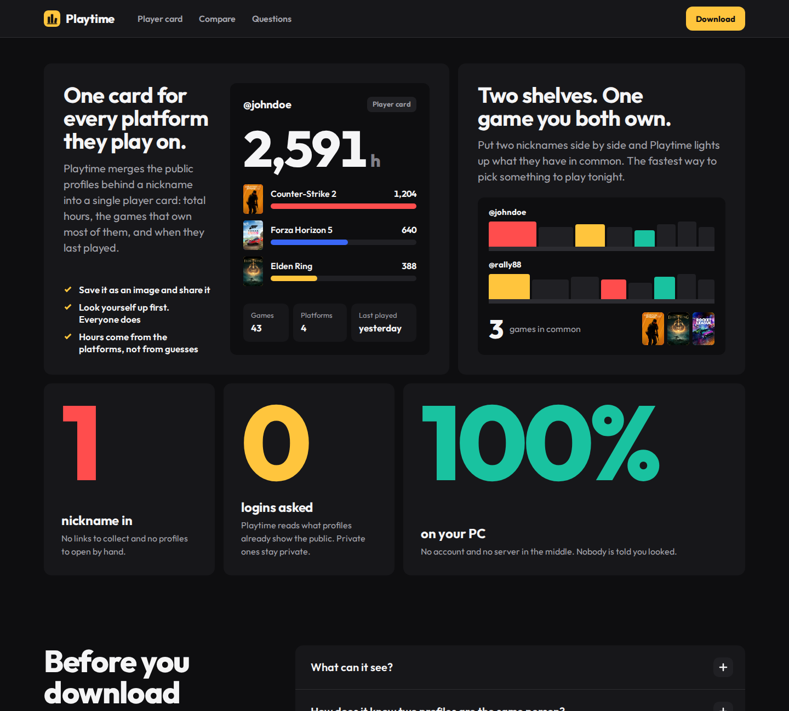
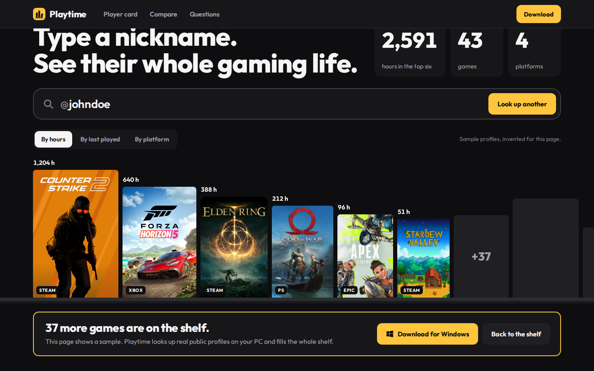

<h1 align="center">Playtime: OSINT lookup of gaming profiles by nickname</h1>

<b>Type a nickname. See their whole gaming life.</b> Every public gaming profile behind a nickname, on one shelf.

OSINT · OSINT tool · gaming profiles · username search · steam · xbox · playstation · SOCMINT · windows

> **Status: v1.1.1.** The app is out — [download Playtime for Windows](https://awesomeosint.tools/playtime/).

## Why this exists

A nickname on a forum is a whole gaming life somewhere else: the games, the hours, the squad. But the profiles are scattered across five platforms.

## Why it is different

Gamer-search tools cover one platform. Playtime checks them all and puts every game on one shelf — what they play, where, and for how long.

## The idea

- **One object.** A shelf of game boxes. The bigger the box, the more hours.
- **One number.** Total hours.
- **Colour.** The page is neutral near-black `#0E0E10`; the spines are the only colour. Buttons are yellow `#FFC53D`.
- **The main feature.** The player card: every platform behind one nickname merged into a single card you can share.

## The demo on the page

A sample nickname types itself into the search box and its games land on the shelf one by one. The shelf can be sorted by hours, by last played or by platform. Six boxes are open; the rest stay dark, and **Open the other 37** points at the download.

